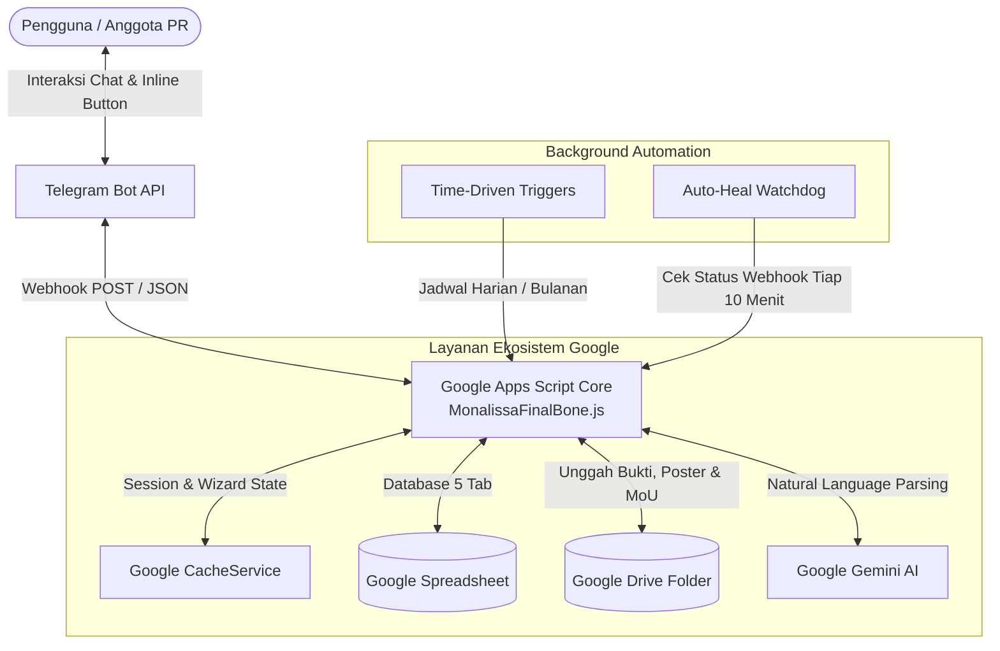

# 💅 Monalissa PR Bot (v2.0)
> **Sistem Asisten Cerdas & Manajemen Terintegrasi Divisi Public Relations Berbasis Serverless Telegram Bot**


---

## 📖 Tentang Proyek

**Monalissa** adalah bot asisten Telegram interaktif yang dikembangkan khusus untuk mengotomatisasi alur kerja operasional Divisi **Public Relations (PR)** secara *end-to-end*. Beroperasi penuh di atas infrastruktur serverless **Google Apps Script (GAS)**, bot ini mengelola 4 pilar utama PR: **Undangan & Delegasi**, **Media Partner**, **Sponsorship**, dan **Partnership**.

Monalissa dilengkapi dengan antarmuka **Clover Navigation (🍀)** berbasis *State Machine* di percakapan pribadi (DM), sistem validasi anggota cerdas, integrasi media Google Drive, pengingat jadwal otomatis, dan pemrosesan bahasa alami (NLP) bertenaga **Google Gemini AI**.

---

## 🏗️ Arsitektur & Diagram Alur Sistem



### Keunggulan Infrastruktur:
- **100% Serverless & Zero Cost:** Berjalan di cloud Google tanpa membutuhkan VPS atau server berbayar.
- **Stateful Form Wizard:** Menggunakan `CacheService` untuk mengelola wawancara input data bertahap tanpa membuat pesan di grup menjadi spam.
- **Auto-Cleaning Dialog:** Pesan pemandu wizard otomatis dibersihkan (`deleteMessage`) setelah proses pengisian selesai.
- **Self-Healing Webhook:** Dilengkapi watchdog berkala untuk mendeteksi error HTTP 302/pending queue dan melakukan auto-reset webhook Telegram secara mandiri.

---

## 🍀 Navigasi Interaktif: The Clover Menu

Monalissa menerapkan sistem navigasi dua lapis. Tombol **Clover Menu** (`ReplyKeyboardMarkup`) tersemat secara persisten di keyboard Telegram percakapan pribadi (DM) dengan `@MonalissaPR_bot`.

```
🍀 MENU UTAMA (DM Monalissa)
├── 🏢 Pekerjaan
│   ├── 📩 Undangan
│   │   ├── 📝 Input Undangan Baru
│   │   ├── 👥 Ambil Delegasi
│   │   ├── 📸 Unggah Bukti Kehadiran
│   │   └── ⚙️ Edit Undangan
│   ├── 🤝 Media Partner
│   │   ├── 📝 Input Medpart Baru
│   │   └── ⚙️ Update Mediapartner (Link Bukti Syarat / Poster Final)
│   ├── 💰 Sponsorship
│   │   ├── 📝 Input Sponsor Baru
│   │   └── ⚙️ Update Sponsor (Status / Dokumen MoU)
│   └── 🔗 Partnership
│       ├── 📝 Input Partner Baru
│       └── ⚙️ Update Partner (Status / Dokumen MoU)
│
├── 📊 Informasi
│   ├── 📅 Jadwal Undangan (Mendatang / Semua / Rekap Bulanan)
│   ├── 📢 Status Media Partner
│   ├── 💼 Status Sponsorship
│   └── 🤝 Status Partnership
│
└── 🛠️ Admin (Hanya muncul untuk Admin terverifikasi)
    ├── 🗑️ Hapus Data (Undangan / Medpart / Sponsor / Partner)
    ├── 📢 Broadcast Pesan ke Seluruh Anggota
    ├── 👥 Cek Daftar Anggota / Delegasi
    └── 🧹 Bersihkan Menu Keyboard Grup
```

> [!TIP]
> Anggota cukup mengetik `/clover` di DM bot untuk memunculkan kembali keyboard permanen apabila tombol sempat tertutup.

---

## 📦 4 Modul Inti Operasional PR

| Modul | Format ID | Tabel Spreadsheet | Input Media | Validasi Khusus |
| :--- | :---: | :--- | :--- | :--- |
| **Undangan** | `Uxx` *(contoh: U01)* | `Undangan` | Foto JPG/PNG (Google Drive) | Anti-duplikat acara, Title Case + Preservasi Akronim (PKM, MKU, dsb.) |
| **Media Partner** | `Mxx` *(contoh: M01)* | `Medpart` | Poster PNG/JPG & Link GDrive | Auto follow-up syarat ghosting (>14 hari) & poster tertunda (>17 hari) |
| **Sponsorship** | `Sxx` *(contoh: S01)* | `Sponsorship` | Dokumen PDF/Word (Google Drive) | Auto ID berurutan, penomoran baris rapi, verifikasi file non-gambar |
| **Partnership** | `Pxx` *(contoh: P01)* | `Partnership` | Dokumen PDF/Word (Google Drive) | PoA UKBA & PoA Eksternal terpisah, periode mulai/selesai, validasi MoU |

---

### 1. 📩 Modul Undangan & Delegasi
- **Input Undangan Baru:** Wizard interaktif memandu input *Pengirim, Nama Kegiatan, Tanggal, Jam, dan Lokasi*. Dilengkapi pembersihan spasi, penyeragaman huruf kapital, dan deteksi duplikasi nama kegiatan.
- **Pengambilan Delegasi (`Ambil Delegasi`):**
  - Anggota memilih undangan yang masih kosong langsung dari menu DM.
  - Bot otomatis memverifikasi nama panggilan. Jika terdapat kesamaan nama, inline keyboard memberikan tombol pilihan spesifik.
  - Data delegasi langsung dicatat ke spreadsheet dan dikonfirmasi ke grup.
- **Unggah Bukti Kehadiran:**
  - Delegasi mengunggah foto kehadiran langsung melalui DM Monalissa (`Menu Pekerjaan -> Undangan -> Unggah Bukti Kehadiran`).
  - Foto dikonversi ke Google Drive publik dan link URL-nya disematkan ke kolom Bukti Kehadiran spreadsheet.
- **Peringatan & Evaluasi Delegasi (H+3):**
  - Jika 3 hari setelah acara delegasi belum mengunggah foto, sistem mengirimkan teguran personal ke DM delegasi dan membuka sesi voting bagi Admin di grup (*Hapus Delegasi* atau *Pertahankan*).

---

### 2. 🤝 Modul Media Partner (Medpart)
- **Input Klien Baru:** Merekam *Instansi, Contact Person, Tanggal Upload Publikasi, dan Link Bukti Syarat (Follow/Like)*.
- **Update Syarat & Poster Final:**
  - Klien yang belum melengkapi link bukti syarat atau poster final dapat diperbarui sewaktu-waktu melalui menu `Update Mediapartner`.
  - Poster final berupa file gambar otomatis disimpan ke Google Drive.
- **Audit Otomatis (Anti-Ghosting):**
  - Peringatan berkala untuk klien yang belum mengumpulkan syarat selama >14 hari (dengan tombol pembatalan bagi admin).
  - Peringatan untuk poster yang belum diterima setelah >17 hari sejak syarat terpenuhi.

---

### 3. 💰 Modul Sponsorship
- **Pencatatan Sponsor:** Merekam *Nama Instansi Perusahaan, Tanggal Pengajuan, Persyaratan, Benefit Timbal-Balik, dan Status Kerjasama*.
- **Integrasi MoU & Proposal:** Mendukung upload berkas perjanjian legalitas dalam format **PDF/Word** langsung ke Google Drive.
- **Auto-ID `Sxx`:** Pengkodean identitas transaksi sponsor yang konsisten dan terurut otomatis.

---

### 4. 🔗 Modul Partnership
- **Pencatatan Mitra:** Merekam kemitraan jangka panjang/strategis, mencakup *Nama Instansi, Periode Kerjasama (Mulai - Selesai), PoA Internal UKBA, dan PoA Eksternal Mitra*.
- **Manajemen MoU:** Upload dan pengarsipan berkas nota kesepahaman (MoU) ke Google Drive.
- **Auto-ID `Pxx`:** Pengkodean transaksi kemitraan berurutan.

---

## 🤖 Kecerdasan Buatan (Gemini AI NLP)

Monalissa terintegrasi dengan Google Gemini AI untuk memproses pesan teks bebas (*natural language processing*) yang dikirimkan oleh anggota di grup atau DM:

- **Pemicu:** Awali pesan dengan `/ai [pesan]` atau panggil bot dengan nama `/monalissa [pesan]`.
- **Kapabilitas:**
  - Menerjemahkan pesan forward undangan dari organisasi lain menjadi format input resmi.
  - Memahami bahasa santai, seperti: *"Monalissa, tolong cek jadwal undangan bulan depan dong"* atau *"Aku mau ambil tugas undangan pelepasan tim besok"*.
  - Mengonversi niat pengguna menjadi instruksi sistem baku secara instan.

---

## ⏱️ Trigger Terjadwal (Background Automation)

Bot berjalan secara otonom menggunakan **Time-Driven Triggers** bawaan Google Apps Script:

| Nama Fungsi Trigger | Jadwal Eksekusi | Deskripsi Tugas |
| :--- | :--- | :--- |
| `reminderBelumAdaDelegasi()` | Setiap Hari (07:00 - 08:00 WIB) | Mengingatkan grup tentang undangan H-2 dan H-1 yang belum memiliki delegasi, dilengkapi link shortcut langsung ke DM `@MonalissaPR_bot`. |
| `reminderDelegasi()` | Setiap Hari (06:00 - 07:00 WIB) | Mengirimkan reminder jadwal H-1 dan Hari H ke grup serta japri (DM) personal ke masing-masing delegasi yang bertugas. |
| `hapusDelegasiTanpaBukti()` | Setiap Hari (20:00 - 21:00 WIB) | Mengecek acara H+3 yang belum memiliki foto kehadiran; mengirim teguran ke delegasi & voting konfirmasi ke admin grup. |
| `reminderMedpart()` | Setiap 3 Hari | Menagih kelengkapan link syarat dan poster media partner yang masih tertunda. |
| `rekapBulanan()` | Tanggal 1 Setiap Bulan | Mengirimkan rekapitulasi data kegiatan dan apresiasi keaktifan anggota divisi ke grup. |
| `autoHealWebhook()` | Setiap 10-15 Menit | Watchdog otomatis untuk mendeteksi koneksi webhook Telegram yang tersumbat (*pending update / error 302*) dan melakukan self-repair. |

---

## 🛠️ Panduan Instalasi & Konfigurasi

### 1. Struktur Tab Spreadsheet
Pastikan Google Spreadsheet memiliki sheet/tab dengan nama berikut:
1. `Undangan`
2. `Medpart` *(atau `Media Partner`)*
3. `Sponsorship` *(atau `Sponsor`)*
4. `Partnership` *(atau `Partner`)*
5. `User_Bot` *(Kolom: No, User ID, Username, Nama Lengkap, Panggilan)*
6. `Admin_Bot` *(Kolom: User ID, Nama Admin)*

### 2. Konfigurasi Script Properties
Buka editor Google Apps Script (**Project Settings ⚙️ -> Script Properties**) dan tambahkan variabel lingkungan berikut:

| Property Key | Nilai / Deskripsi |
| :--- | :--- |
| `TELEGRAM_TOKEN` | Token Bot API dari `@BotFather` |
| `SPREADSHEET_ID` | ID berkas Google Spreadsheet database |
| `GROUP_CHAT_ID` | Chat ID grup utama Telegram PR (contoh: `-100xxxxxxxxxx`) |
| `DRIVE_FOLDER_ID` | ID folder Google Drive tujuan penyimpanan media |
| `GEMINI_API_KEY` | API Key dari Google AI Studio |
| `WEBHOOK_URL` | URL hasil Deploy Web App Google Apps Script |

### 3. Pemasangan Webhook
1. Lakukan **Deploy -> New Deployment** sebagai **Web App** (`Execute as: Me`, `Who has access: Anyone`).
2. Salin Web App URL yang dihasilkan ke properti `WEBHOOK_URL`.
3. Jalankan fungsi `setWebhook()` satu kali di editor Apps Script untuk menghubungkan Telegram ke Web App.

---

## 📁 Struktur Berkas Repositori

```
serverless-telegram-pr-bot/
├── MonalissaFinalBone.js       # Core engine tunggal produksi (GAS) berisi seluruh fitur
├── cloudflare-worker.js        # Reverse proxy Cloudflare Worker (opsional, untuk bypass latency)
├── README.md                   # Dokumentasi resmi sistem dan petunjuk operasional
├── GAS_TELEGRAM_BOT_SKILLS.md  # Best-practice arsitektur, reusable design pattern, & skills bot
├── Interactive/                # Arsip referensi komponen wizard state & keyboard
└── Code.js                     # Legacy monolithic baseline
```

---

*Dikelola dengan ❤️ dan 💅 oleh Divisi Public Relations.*
